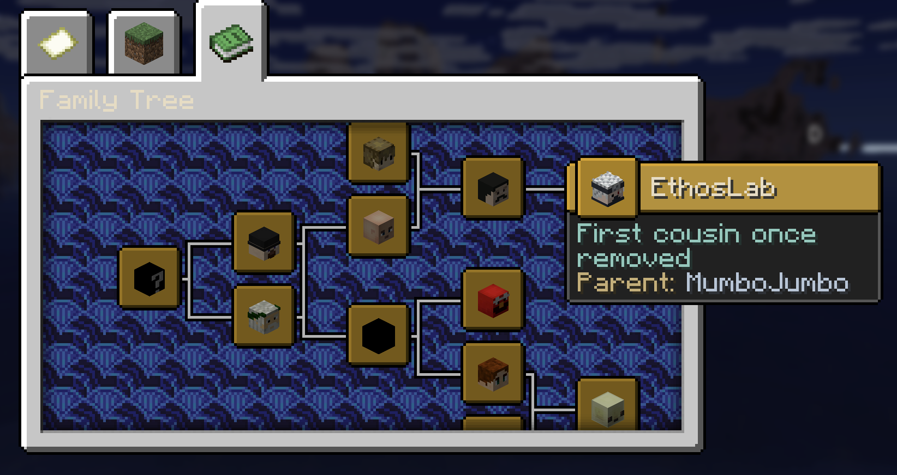

# Family tree

The family tree shows recorded parents, children and partners, including offline players.

## Open a tree

1. Run `/faith family` for your own tree. You can also open **/faith → Family** and select a person.
2. Press your Advancements key, normally **L**, and select **Family Tree** if needed.
3. Hover over a head to read its relationships. Pan around to follow the branches.

Use `/faith family <player>` to focus on someone else. `/faith family <player> <depth>` changes how far the tree reaches: 0–8, with a default of 3.

## Understand the connections

Partner links come from completed [marriages](marriage.md). Parent and child links come from active [adoptions](adoption.md). Marriage alone does not create a parent relationship, and divorce does not remove parents. Ending an adoption removes that direct link from the tree; historical ancestry still protects against incest and cycles.

When viewing someone else's tree, the descriptions refer to them. Browsing a tree changes no relationships.

??? tip "A relative or branch is missing"

    Large trees show part of the family at a time. If chat says **More branches…**, focus on another relative or change the depth. A pending marriage or adoption will not appear until it completes; check `/faith pending`.

??? tip "The tree did not open"

    Check your Advancements key binding, run `/faith family` again, then select **Family Tree**. If the tab is missing, ask the server owner to check the [supported server setup](../server/installation.md).

Use `/faith relationships` to propose [marriage](marriage.md), request [adoption](adoption.md) or review requests. See the [command reference](../reference/commands.md) for shortcuts.
