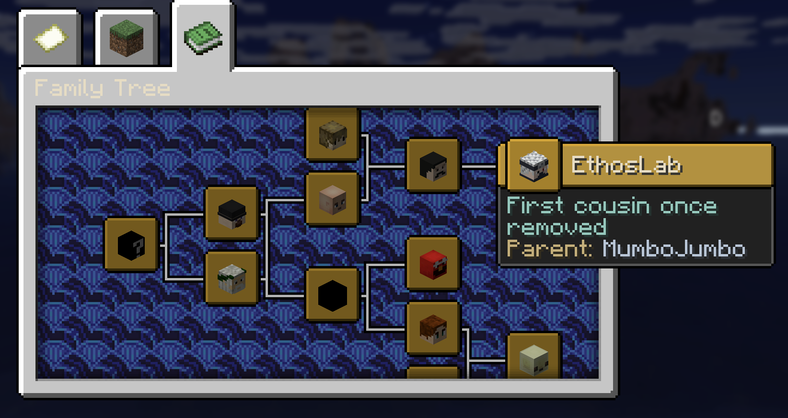

# Family tree

Use the family tree to explore recorded parents, children and partners, including players who are offline.

## Open a tree

1. Run `/faith family` for your own tree. You can also open **/faith → Family** and select a person.
2. Press your **Advancements key**—normally **L**—and open the **Family Tree** tab if needed.
3. Hover over a person's head to read their relationships. Move around the advancement view to explore the branches.

To focus on someone else, use `/faith family <player>`. To adjust how far the view explores, use `/faith family <player> <depth>` with a depth from **0 to 8**. The default is **3**.

## Understand the connections

Partner links come from completed [marriages](marriage.md). Parent and child links come from completed [adoptions](adoption.md). Marriage alone does not create a parent relationship, and divorce does not remove recorded parents.

When you focus on someone else, relationship descriptions refer to that person. The tree is a view of the family record; opening or browsing it does not change relationships.

??? tip "A relative or branch is missing"

    Large trees show a bounded view. If chat says **More branches…**, focus on another relative or try a different depth. Check that the relevant marriage or adoption actually completed; a pending request is not a relationship. Use `/faith pending` to review it.

??? tip "The tree did not open"

    Use your configured Advancements key rather than assuming it is L. Run `/faith family` again, then select **Family Tree**. If the tab is unavailable, ask the server owner to check the [supported server setup](../server/installation.md).

Use `/faith relationships` to propose [marriage](marriage.md), request [adoption](adoption.md) or review requests. See the [command reference](../reference/commands.md) for shortcuts.
