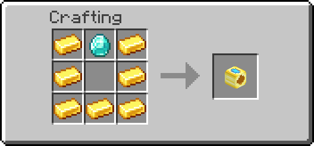

# How to marry

Everyone must agree to the same partner group. You can marry without a priest.

## Send a proposal

1. Hold a Marriage Ring in your main hand and right-click the other player.
2. Check the heads in **Propose marriage**. If either of you has partners, the whole group is included.
3. Choose **Send proposal**. Any rule stopping the marriage appears above this button.
4. Everyone else clicks **Yes** in chat. **No** declines; **Details** opens the request. Sending it counts as your own consent.
5. Once everyone accepts, you are married. One ring is used from the proposer's inventory.

The proposer must be online with a ring to finish. If an accepted request is waiting, use `/faith pending` → request → **Finish marriage** once they are ready.

<!-- Screenshot: proposal preview showing both player heads and Send proposal; chat Yes/No/Details below. -->

You can also open `/faith relationships` → **Propose marriage**, then choose a nearby player while holding the ring.

## Craft the ring

The default recipe uses seven gold ingots and one diamond. The diamond goes at the top centre; leave the centre empty.

{ .recipe-figure }

Your server may change the recipe or disable crafting.

## Choose a ceremony instead

Choose **Plan ceremony** in the proposal preview. After everyone accepts:

1. Open the request in `/faith pending` and select **Priest help**.
2. Arrange a compatible priest who is not one of the partners.
3. Meet with every participant and the priest in the same world, within **32 blocks** by default. The priest completes the marriage.

The ceremony also uses one ring on successful completion.

??? tip "Why is my proposal blocked?"

    Check the named blockers in the preview. Every participant's faith must allow the group size and any interfaith marriage. Relatives, including adoptive relatives, cannot marry. Two existing marriage groups cannot merge.

    If a partner group or membership changes, review a fresh proposal. Requests expire after **5 minutes** by default. **Cancel request** or **Decline** ends a pending proposal without using a ring.

??? info "What changes after marriage?"

    Everyone in the group is married to everyone else. Supported XP gains are shared among online partners: one keeps 100%; two receive 60% each; three receive 40% each. Larger groups divide the 120% pool equally. Distance and world do not matter.

    Marriage does not create parents or children. Use [adoption](adoption.md) for that.

[Family tree](family-tree.md) · [Divorce](divorce.md)
